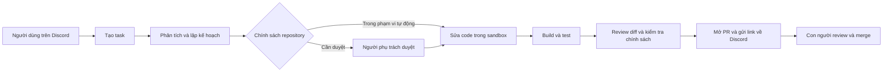

# ai-agents-workflow

**DevAgent** là nền tảng điều phối công việc lập trình bằng AI. Mục tiêu MVP là nhận mô tả lỗi trên Discord, phân tích repository, sửa code trong môi trường cách ly, chạy build/test, review thay đổi và mở pull request để con người xem xét, merge.

Repository hiện cung cấp **nền tảng Phase 1 và bước Planner**. Bạn có thể tạo task trên dashboard, xem kế hoạch, quyết định phê duyệt và theo dõi lịch sử thực thi. Luồng sửa code và tạo PR thật thuộc các bước tiếp theo trong [checklist MVP](docs/MVP-CHECKLIST.md).

## Luồng mục tiêu



Build/test thất bại hoặc review còn lỗi chặn thì task phải được xử lý tiếp trước khi xuất bản. Thay đổi nhạy cảm cần phê duyệt theo chính sách. Người dùng có thể hủy task và theo dõi chi phí từng lần chạy.

## Chức năng hiện có

| Thành phần | Khả năng hiện tại |
| --- | --- |
| Project và repository | Tạo project, quản lý thành viên và vai trò, đăng ký repo cùng chính sách đường dẫn |
| Task | Tạo với khóa chống trùng, xem, lọc, phân trang, hủy, bổ sung thông tin và thử lại |
| Planner | Lấy danh sách file qua adapter, lập kế hoạch, xác định đường dẫn ảnh hưởng, ghi token và chi phí ước tính |
| Chính sách và phê duyệt | Kiểm tra phạm vi tự động, vùng nhạy cảm, yêu cầu duyệt gắn với phiên bản kế hoạch |
| Quy trình theo repo | Khai báo, có phiên bản và lịch sử: cổng duyệt, số lần thử, vòng sửa, ngưỡng Reviewer, model theo bước, cài đặt PR, thông báo. Task giữ ảnh chụp quy trình lúc bắt đầu |
| Worker | Hàng đợi PostgreSQL, lease có gia hạn, heartbeat, backoff/Retry-After, giới hạn đồng thời theo loại job, dead-letter và đối soát trạng thái task |
| Ngân sách | Trần đầu ra của mỗi lần gọi model tính theo ngân sách USD/token ước tính còn lại, giới hạn số lần gọi kể cả request lỗi, từ chối khi thiếu đơn giá |
| Đăng nhập và quản trị | JWT ngắn hạn, refresh cookie HttpOnly xoay vòng, buộc đổi mật khẩu tạm, quản trị người dùng và thành viên project |
| Dashboard | Danh sách task, chi tiết, timeline, execution, phê duyệt và chỉnh quy trình; cập nhật bằng SignalR |
| AI | Adapter giả lập xác định cho development/test và adapter Anthropic có thể cấu hình |
| Discord | Thông báo qua outbox bền vững (ghi cùng giao dịch, thử lại, tôn trọng giới hạn tần suất, chống gửi trùng bằng nonce) |
| Vận hành | Health check, structured log, OpenTelemetry, migration, Docker và GitHub Actions |

**Phần đang chờ triển khai** gồm nhận slash command Discord, GitHub App và webhook thật, Coding/Testing/Reviewer/Publisher, sandbox Docker và xuất bản PR. Adapter GitHub hiện dùng dữ liệu giả lập ở development. Chọn `GitHub:Mode=App` sẽ báo tích hợp chưa sẵn sàng.

## Kiến trúc

Backend tổ chức theo Clean Architecture với domain và use case chia theo tính năng. API và Worker chạy thành hai tiến trình, dùng chung PostgreSQL. Domain độc lập với ASP.NET Core, EF Core và SDK AI. Application định nghĩa hợp đồng để Infrastructure triển khai các tích hợp.

```text
backend/
  src/
    DevAgent.Domain/          Task, project, policy, approval, agent, execution
    DevAgent.Application/     Use case, phân quyền, orchestration và hợp đồng tích hợp
    DevAgent.Infrastructure/  EF Core, PostgreSQL, AI, thông báo và observability
    DevAgent.Api/             REST API, xác thực, SignalR và health check
    DevAgent.Worker/          Nhận job, chạy Planner và ghi tiến độ
  tests/                     Domain, application, kiến trúc và API integration
frontend/                    React, TypeScript, TanStack Query, React Router, SignalR
secrets/                     Hướng dẫn cấp file secret cục bộ
docs/MVP-CHECKLIST.md        Phạm vi, thứ tự triển khai và tiêu chí nghiệm thu
.github/workflows/ci.yml     Kiểm tra backend, frontend, migration và Docker images
```

Phân biệt `AgentProfile` là cấu hình, `AgentInstance` là một instance hoạt động và `AgentExecution` là một lần chạy cụ thể. Task giữ lịch sử chuyển trạng thái. Execution giữ kết quả và usage. Approval gắn với nội dung cần duyệt. PostgreSQL lưu cả dữ liệu và job bền vững, đồng thời chuyển thông báo realtime từ Worker sang API.

### Độ tin cậy của hàng đợi

- **Lease**: Worker gia hạn lease định kỳ. Lỗi gia hạn tạm thời được thử lại khi lease còn hạn; quá hạn mà chưa gia hạn được thì hủy công việc và không ghi kết quả. Mỗi job luôn trả lại lượt xử lý dù có lỗi ở bất kỳ bước nào.
- **Dead-letter và đối soát**: job hết lượt thử, bị lỗi vĩnh viễn, hoặc Worker chết ở lần thử cuối đều chuyển dead-letter. Dịch vụ đối soát trong Worker chuyển task sang `FAILED`, đóng execution còn treo kèm lý do lỗi cuối. Chỉ xác nhận đã đối soát khi handler thành công. Tiến trình chết giữa chừng thì lease đối soát hết hạn sau 5 phút và Worker khác nhận lại.
- **Outbox thông báo**: job gửi thông báo được ghi trong cùng giao dịch với thay đổi trạng thái, nên tiến trình dừng hay Discord lỗi đều không làm mất thông báo. Lỗi 429 chờ đúng `Retry-After`, lỗi 5xx và lỗi mạng được thử lại, lỗi 401/403/404 vào dead-letter ngay.
- **Trần đồng thời** `AgentLimits:MaxConcurrentTasks` chỉ áp cho job xử lý task; job thông báo không bị chặn bởi task đang chạy.

## Chạy thử trên máy phát triển

Cần .NET SDK 10 theo [global.json](backend/global.json), Node.js 24, npm và Docker có hỗ trợ Linux containers. Các lệnh dưới đây dùng PowerShell, bắt đầu tại thư mục gốc repository.

### Cách nhanh nhất: toàn bộ hệ thống bằng Docker Compose

```powershell
Copy-Item .env.example .env
# Mở .env, đặt POSTGRES_PASSWORD, AUTH_JWT_SIGNING_KEY và BOOTSTRAP_ADMIN_PASSWORD.
docker compose up -d --build
```

Mở dashboard tại `http://localhost:8080`, API tại `http://localhost:5080`. Mặc định `APP_ENVIRONMENT=Development` nên AI và GitHub dùng bản giả lập. Đăng nhập bằng `BOOTSTRAP_ADMIN_EMAIL` và mật khẩu tạm đã đặt trong `.env`, sau đó đổi mật khẩu theo yêu cầu.

Hệ thống chỉ khởi tạo Super Admin đầu tiên. Từ trang **Người dùng**, tạo tài khoản cho người tham gia. Từ trang **Project**, tạo project, gán Owner, thêm thành viên và đăng ký repo. Với GitHub giả lập, có thể dùng Installation ID `1`, repo `devagent-pilot/sample-app` và nhánh `main` để kiểm tra luồng Planner. Các mục dưới đây dành cho khi cần chạy từng tiến trình để debug.

Khóa ký JWT cần ít nhất 32 byte và được giữ ổn định qua các lần khởi động. Có thể tạo chuỗi ngẫu nhiên bằng `openssl rand -base64 48`. Mật khẩu tạm phải đạt chính sách cấu hình của backend, mặc định ít nhất 10 ký tự, gồm chữ hoa, chữ thường và số. Ở môi trường HTTPS, đặt `AUTH_COOKIE_SECURE=true`.

### Khởi động PostgreSQL

```powershell
Copy-Item .env.example .env
# Mở .env, đặt POSTGRES_PASSWORD cho môi trường của bạn.
docker compose up -d postgres
```

Nếu `.env` đã tồn tại, dùng cấu hình hiện có. API và Worker khi chạy trực tiếp cần cùng chuỗi kết nối với PostgreSQL trong Compose. Compose đọc `.env` để nội suy cấu hình, còn `dotnet run` đọc biến môi trường của terminal.

### Chạy API

Trong terminal thứ nhất, thay mật khẩu ví dụ bằng giá trị vừa đặt trong `.env`.

```powershell
$env:ConnectionStrings__Postgres = 'Host=localhost;Port=5432;Database=devagent;Username=devagent;Password=<POSTGRES_PASSWORD>'
$env:Auth__Jwt__SigningKey = '<AUTH_JWT_SIGNING_KEY>'
$env:Bootstrap__SuperAdmin__Email = '<BOOTSTRAP_ADMIN_EMAIL>'
$env:Bootstrap__SuperAdmin__Password = '<BOOTSTRAP_ADMIN_PASSWORD>'
Set-Location backend
dotnet tool restore
dotnet run --project src/DevAgent.Api
```

Ở môi trường Development, API áp migration và khởi tạo Super Admin nếu chưa có. API nghe tại `http://localhost:5080`. Kiểm tra `http://localhost:5080/health/ready` hoặc hợp đồng API ở `http://localhost:5080/openapi/v1.json`.

### Chạy Worker

Mở terminal thứ hai tại gốc repository.

```powershell
$env:ConnectionStrings__Postgres = 'Host=localhost;Port=5432;Database=devagent;Username=devagent;Password=<POSTGRES_PASSWORD>'
Set-Location backend
dotnet run --project src/DevAgent.Worker
```

### Chạy dashboard

Mở terminal thứ ba tại gốc repository.

```powershell
Set-Location frontend
npm ci
npm run dev
```

Mở `http://localhost:5173` và đăng nhập bằng tài khoản đã tạo. Vite chuyển tiếp `/api` và `/hubs` đến API. Access token giữ trong bộ nhớ, refresh token nằm trong cookie HttpOnly. Khi đăng xuất, dashboard xóa dữ liệu phiên và dừng kết nối realtime.

### Kiểm tra luồng Planner

Tạo project và đăng ký một repo như hướng dẫn ở trên, sau đó tạo task mô tả lỗi bộ lọc trạng thái và quan sát timeline.

| Mô tả thử nghiệm với AI giả lập | Kết quả mong đợi |
| --- | --- |
| Mô tả lỗi thông thường | Sinh kế hoạch, sau đó đến `BLOCKED` vì bước Coding chưa triển khai |
| Mô tả chứa `[sensitive]` | Kế hoạch liên quan đến xác thực, chuyển `WAITING_FOR_APPROVAL` |
| Mô tả chứa `[clarify]` | Chuyển `NEEDS_CLARIFICATION` và hiển thị câu hỏi bổ sung |

Các marker này thuộc adapter AI giả lập. Sau khi duyệt kế hoạch nhạy cảm, task tiếp tục đến điểm dừng của bước Coding.

## Quy trình theo repo (mức 2)

Mỗi repo có một quy trình khai báo, sửa ở dashboard (**Repo & quy trình**) hoặc qua `GET/PUT /api/v1/repositories/{id}/workflow`. Repo chưa sửa dùng quy trình mặc định của hệ thống (v0).

| Tùy chỉnh | Lựa chọn |
| --- | --- |
| Duyệt kế hoạch / duyệt diff | `ON_SENSITIVE` (theo chính sách repo) hoặc `ALWAYS` |
| Số lần thử Planner trong một lượt | 1..5 |
| Số vòng sửa–test | 0..trần `AgentLimits:MaxFixIterations` |
| Ngưỡng Reviewer chặn xuất bản | `LOW`, `MEDIUM`, `HIGH` |
| Yêu cầu test hồi quy, PR draft, nhãn, tiền tố tiêu đề, người được yêu cầu review | Theo repo |
| Model cho Planner/Coding/Reviewer | Ghi đè model mặc định; model phải có đơn giá trong `Ai:Pricing` |
| Thông báo Discord | Bật/tắt từng sự kiện; `APPROVAL_REQUIRED`, `COMPLETED`, `FAILED` luôn bật |

Quy trình **chỉ được siết chặt hơn** các ràng buộc an toàn, không nới lỏng. Không có lựa chọn bỏ duyệt vùng nhạy cảm, bỏ bước, cho agent tự duyệt hay nới ngưỡng Reviewer tới `CRITICAL`; API trả 400 nếu gửi các giá trị đó. Mỗi lần sửa phải gửi `expectedVersion` (sai thì trả 409), tạo một phiên bản mới kèm lý do trong lịch sử và một bản ghi audit. Task chụp quy trình lúc bắt đầu lập kế hoạch, nên đổi quy trình giữa chừng không ảnh hưởng task đang chạy.

Hiện quy trình đã điều khiển bước Planner (cổng duyệt kế hoạch, số lần thử, model) và việc gửi thông báo. Các trường cho Coding, Reviewer, duyệt diff và PR được lưu, kiểm tra hợp lệ và chụp vào task; chúng có hiệu lực khi các bước đó được triển khai ở Phase 2B–2C. Orchestrator đã tách thành các bước `IWorkflowStep` để cắm bước mới theo trạng thái task.

## Cấu hình và secret

[.env.example](.env.example) liệt kê biến cho Compose. Các file `appsettings.json` và `appsettings.{Environment}.json` cấu hình API/Worker. Dùng biến môi trường với dấu `__` cho cấu hình phân cấp, chẳng hạn `Ai__Provider` và `Ai__Anthropic__ApiKey`.

| Nhóm | Mục đích |
| --- | --- |
| `ConnectionStrings`, `Database` | Kết nối PostgreSQL, migration và seed |
| `Auth`, `Bootstrap`, `Cors`, `RateLimiting` | JWT, refresh cookie, chính sách mật khẩu, Super Admin đầu tiên, origin và hạn mức request |
| `Ai`, `GitHub`, `Discord` | Chọn adapter và cấp thông tin tích hợp |
| `AgentLimits`, `JobQueue`, `Worker` | Ngân sách, token, timeout, retry, lease và số job đồng thời |
| `Security`, `Observability`, `PublicUrls` | Khóa mã hóa credential, log/trace/metric và link dashboard |

`.gitignore` loại `.env`, private key, cấu hình local, dependencies và đầu ra build. Các template cùng cấu hình frontend development/production được đưa vào Git. Dùng biến môi trường hoặc secret store để cấp token thật, xem thêm [secrets/README.md](secrets/README.md). Mọi biến `VITE_*` đều xuất hiện trong bundle trình duyệt và chỉ được chứa thông tin công khai.

Dashboard đóng gói trong Docker đọc **cấu hình runtime** từ `/config.js`, do container sinh lúc khởi động từ `DEVAGENT_ENVIRONMENT`, `DEVAGENT_API_BASE_URL`, `DEVAGENT_SIGNALR_HUB_PATH` và `DEVAGENT_APP_NAME`. Một image dùng được cho nhiều môi trường. Khi chạy `npm run dev`, dashboard dùng biến `VITE_*`. File [docker-compose.github-app.yml](docker-compose.github-app.yml) chuẩn bị cách cấp private key cho adapter GitHub App trong giai đoạn tiếp theo.

Để xem trace/metric/log cục bộ, bật profile `observability`, đặt `OTLP_ENDPOINT=http://otel-lgtm:4317` trong cấu hình Compose và khởi động lại API/Worker khi chạy chúng bằng container. Grafana được công bố ở `http://localhost:3000`. Với tiến trình chạy trực tiếp trên host, dùng `Observability__OtlpEndpoint=http://localhost:4317`.

## Kiểm tra trước khi mở PR

```powershell
# Từ gốc repository
Set-Location backend
dotnet restore DevAgent.slnx
dotnet tool restore
dotnet build DevAgent.slnx -c Release --no-restore
dotnet test DevAgent.slnx -c Release --no-build
dotnet ef migrations has-pending-model-changes --project src/DevAgent.Infrastructure --startup-project src/DevAgent.Api --no-build --configuration Release

Set-Location ../frontend
npm ci
npm run typecheck
npm run lint
npm test
npm run build
```

Integration test dùng Testcontainers nên cần Docker đang chạy. Test thông thường dùng model giả lập, kết quả xác định. Workflow CI còn áp migration lên PostgreSQL mới và build ba image API, Worker, dashboard.

Khi thay đổi model dữ liệu, tạo migration từ thư mục `backend` và review SQL sinh ra.

```powershell
dotnet ef migrations add <MigrationName> --project src/DevAgent.Infrastructure --startup-project src/DevAgent.Api --output-dir Persistence/Migrations
```

## Thứ tự phát triển tiếp theo

1. Hoàn thiện thiết kế Phase 0, ERD, ranh giới quyền và kịch bản nghiệm thu trong checklist.
2. Kết nối GitHub App thật để đọc đúng repo và base commit.
3. Xây sandbox cùng công cụ sửa file, build/test và review có giới hạn tài nguyên.
4. Xuất bản PR từ đúng commit đã kiểm tra, xử lý gửi trùng và phục hồi khi Worker gián đoạn.
5. Nhận lệnh Discord, bổ sung webhook và chạy E2E từ giao việc đến PR.

Mỗi thay đổi nên có nhánh riêng và commit theo phần. PR mô tả vấn đề, kết quả, phạm vi, cách kiểm tra và các giới hạn còn tồn tại để người review có đủ thông tin quyết định merge.
