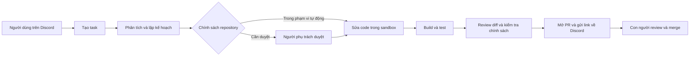

# ai-agents-workflow

**DevAgent** là nền tảng điều phối công việc lập trình bằng AI. Mục tiêu MVP là nhận mô tả lỗi trên Discord, phân tích repository, sửa code trong môi trường cách ly, chạy build/test, review thay đổi và mở pull request để con người xem xét, merge.

Repository hiện cung cấp **nền tảng Phase 1 và bước Planner**. Bạn có thể tạo task trên dashboard, xem kế hoạch, quyết định phê duyệt và theo dõi lịch sử thực thi. Luồng sửa code và tạo PR thật thuộc các bước tiếp theo trong [checklist MVP](docs/MVP-CHECKLIST.md).

## Luồng mục tiêu



Build/test thất bại hoặc review còn lỗi chặn thì task phải được xử lý tiếp trước khi xuất bản. Thay đổi nhạy cảm cần phê duyệt theo chính sách. Người dùng có thể hủy task và theo dõi chi phí từng lần chạy.

## Chức năng hiện có

| Thành phần | Khả năng hiện tại |
| --- | --- |
| Project và repository | Tạo project, quản lý thành viên và vai trò, đăng ký repo cùng chính sách đường dẫn |
| Task | Tạo với khóa chống trùng, xem, lọc, phân trang, hủy, bổ sung thông tin và thử lại |
| Planner | Lấy danh sách file qua adapter, lập kế hoạch, xác định đường dẫn ảnh hưởng, ghi token và chi phí ước tính |
| Chính sách và phê duyệt | Kiểm tra phạm vi tự động, vùng nhạy cảm, yêu cầu duyệt gắn với phiên bản kế hoạch |
| Worker | Hàng đợi PostgreSQL, lease, heartbeat, backoff, giới hạn đồng thời và dead-letter |
| Dashboard | Danh sách task, chi tiết, timeline, execution và phê duyệt; cập nhật bằng SignalR |
| AI | Adapter giả lập xác định cho development/test và adapter Anthropic có thể cấu hình |
| Discord | Gửi thông báo qua REST khi cấu hình bot và kênh nhận |
| Vận hành | Health check, structured log, OpenTelemetry, migration, Docker và GitHub Actions |

**Phần đang chờ triển khai** gồm nhận slash command Discord, GitHub App và webhook thật, Coding/Testing/Reviewer/Publisher, sandbox Docker và xuất bản PR. Adapter GitHub hiện dùng dữ liệu giả lập ở development. Chọn `GitHub:Mode=App` sẽ báo tích hợp chưa sẵn sàng. Frontend có hỗ trợ gửi bearer token nhưng luồng đăng nhập OIDC vẫn cần hoàn thiện.

## Kiến trúc

Backend tổ chức theo Clean Architecture với domain và use case chia theo tính năng. API và Worker chạy thành hai tiến trình, dùng chung PostgreSQL. Domain độc lập với ASP.NET Core, EF Core và SDK AI. Application định nghĩa hợp đồng để Infrastructure triển khai các tích hợp.

```text
backend/
  src/
    DevAgent.Domain/          Task, project, policy, approval, agent, execution
    DevAgent.Application/     Use case, phân quyền, orchestration và hợp đồng tích hợp
    DevAgent.Infrastructure/  EF Core, PostgreSQL, AI, thông báo và observability
    DevAgent.Api/             REST API, xác thực, SignalR và health check
    DevAgent.Worker/          Nhận job, chạy Planner và ghi tiến độ
  tests/                     Domain, application, kiến trúc và API integration
frontend/                    React, TypeScript, TanStack Query, React Router, SignalR
secrets/                     Hướng dẫn cấp file secret cục bộ
docs/MVP-CHECKLIST.md        Phạm vi, thứ tự triển khai và tiêu chí nghiệm thu
.github/workflows/ci.yml     Kiểm tra backend, frontend, migration và Docker images
```

Phân biệt `AgentProfile` là cấu hình, `AgentInstance` là một instance hoạt động và `AgentExecution` là một lần chạy cụ thể. Task giữ lịch sử chuyển trạng thái. Execution giữ kết quả và usage. Approval gắn với nội dung cần duyệt. PostgreSQL lưu cả dữ liệu và job bền vững, đồng thời chuyển thông báo realtime từ Worker sang API.

## Chạy thử trên máy phát triển

Cần .NET SDK 10 theo [global.json](backend/global.json), Node.js 24, npm và Docker có hỗ trợ Linux containers. Các lệnh dưới đây dùng PowerShell, bắt đầu tại thư mục gốc repository.

### Khởi động PostgreSQL

```powershell
Copy-Item .env.example .env
# Mở .env, đặt POSTGRES_PASSWORD cho môi trường của bạn.
docker compose up -d postgres
```

Nếu `.env` đã tồn tại, dùng cấu hình hiện có. API và Worker khi chạy trực tiếp cần cùng chuỗi kết nối với PostgreSQL trong Compose. Compose đọc `.env` để nội suy cấu hình, còn `dotnet run` đọc biến môi trường của terminal.

### Chạy API

Trong terminal thứ nhất, thay mật khẩu ví dụ bằng giá trị vừa đặt trong `.env`.

```powershell
$env:ConnectionStrings__Postgres = 'Host=localhost;Port=5432;Database=devagent;Username=devagent;Password=<POSTGRES_PASSWORD>'
Set-Location backend
dotnet tool restore
dotnet run --project src/DevAgent.Api
```

Ở môi trường Development, API áp migration, seed project `Pilot` cùng repo giả lập và dữ liệu người dùng. API nghe tại `http://localhost:5080`. Kiểm tra `http://localhost:5080/health/ready` hoặc hợp đồng API ở `http://localhost:5080/openapi/v1.json`.

### Chạy Worker

Mở terminal thứ hai tại gốc repository.

```powershell
$env:ConnectionStrings__Postgres = 'Host=localhost;Port=5432;Database=devagent;Username=devagent;Password=<POSTGRES_PASSWORD>'
Set-Location backend
dotnet run --project src/DevAgent.Worker
```

### Chạy dashboard

Mở terminal thứ ba tại gốc repository.

```powershell
Set-Location frontend
npm ci
npm run dev
```

Mở `http://localhost:5173`. Vite chuyển tiếp `/api` và `/hubs` đến API. Cấu hình development gửi danh tính Owner của dữ liệu seed bằng header `X-DevAgent-User`.

### Kiểm tra luồng Planner

Tạo task trên repo của project `Pilot`, nhập mô tả lỗi bộ lọc trạng thái và quan sát timeline.

| Mô tả thử nghiệm với AI giả lập | Kết quả mong đợi |
| --- | --- |
| Mô tả lỗi thông thường | Sinh kế hoạch, sau đó đến `BLOCKED` vì bước Coding chưa triển khai |
| Mô tả chứa `[sensitive]` | Kế hoạch liên quan đến xác thực, chuyển `WAITING_FOR_APPROVAL` |
| Mô tả chứa `[clarify]` | Chuyển `NEEDS_CLARIFICATION` và hiển thị câu hỏi bổ sung |

Các marker này thuộc adapter AI giả lập. Sau khi duyệt kế hoạch nhạy cảm, task tiếp tục đến điểm dừng của bước Coding.

## Cấu hình và secret

[.env.example](.env.example) liệt kê biến cho Compose. Các file `appsettings.json` và `appsettings.{Environment}.json` cấu hình API/Worker. Dùng biến môi trường với dấu `__` cho cấu hình phân cấp, chẳng hạn `Ai__Provider` và `Ai__Anthropic__ApiKey`.

| Nhóm | Mục đích |
| --- | --- |
| `ConnectionStrings`, `Database` | Kết nối PostgreSQL, migration và seed |
| `Auth`, `Cors`, `RateLimiting` | JWT/OIDC, danh tính development, origin và hạn mức request |
| `Ai`, `GitHub`, `Discord` | Chọn adapter và cấp thông tin tích hợp |
| `AgentLimits`, `JobQueue`, `Worker` | Ngân sách, token, timeout, retry, lease và số job đồng thời |
| `Security`, `Observability`, `PublicUrls` | Khóa mã hóa credential, log/trace/metric và link dashboard |

`.gitignore` loại `.env`, private key, cấu hình local, dependencies và đầu ra build. Các template cùng cấu hình frontend development/production được đưa vào Git. Dùng biến môi trường hoặc secret store để cấp token thật, xem thêm [secrets/README.md](secrets/README.md). Mọi biến `VITE_*` đều xuất hiện trong bundle trình duyệt và chỉ được chứa thông tin công khai.

Chế độ xác thực development dùng cho môi trường phát triển. Bản build frontend production kiểm tra và từ chối `VITE_AUTH_MODE=development`. Vì Compose hiện mặc định truyền chế độ này vào dịch vụ `web`, luồng chạy thử được hướng dẫn ở trên dùng Vite. Để phục vụ dashboard đóng gói trong Docker, cần cấu hình `WEB_AUTH_MODE=oidc` và hoàn thiện luồng cấp token đăng nhập. File [docker-compose.github-app.yml](docker-compose.github-app.yml) chuẩn bị cách cấp private key cho adapter GitHub App trong giai đoạn tiếp theo.

Để xem trace/metric/log cục bộ, bật profile `observability`, đặt `OTLP_ENDPOINT=http://otel-lgtm:4317` trong cấu hình Compose và khởi động lại API/Worker khi chạy chúng bằng container. Grafana được công bố ở `http://localhost:3000`. Với tiến trình chạy trực tiếp trên host, dùng `Observability__OtlpEndpoint=http://localhost:4317`.

## Kiểm tra trước khi mở PR

```powershell
# Từ gốc repository
Set-Location backend
dotnet restore DevAgent.slnx
dotnet tool restore
dotnet build DevAgent.slnx -c Release --no-restore
dotnet test DevAgent.slnx -c Release --no-build
dotnet ef migrations has-pending-model-changes --project src/DevAgent.Infrastructure --startup-project src/DevAgent.Api --no-build --configuration Release

Set-Location ../frontend
npm ci
npm run typecheck
npm run lint
npm test
npm run build
```

Integration test dùng Testcontainers nên cần Docker đang chạy. Test thông thường dùng model giả lập, kết quả xác định. Workflow CI còn áp migration lên PostgreSQL mới và build ba image API, Worker, dashboard.

Khi thay đổi model dữ liệu, tạo migration từ thư mục `backend` và review SQL sinh ra.

```powershell
dotnet ef migrations add <MigrationName> --project src/DevAgent.Infrastructure --startup-project src/DevAgent.Api --output-dir Persistence/Migrations
```

## Thứ tự phát triển tiếp theo

1. Hoàn thiện thiết kế Phase 0, ERD, ranh giới quyền và kịch bản nghiệm thu trong checklist.
2. Kết nối GitHub App thật để đọc đúng repo và base commit.
3. Xây sandbox cùng công cụ sửa file, build/test và review có giới hạn tài nguyên.
4. Xuất bản PR từ đúng commit đã kiểm tra, xử lý gửi trùng và phục hồi khi Worker gián đoạn.
5. Nhận lệnh Discord, bổ sung webhook, luồng đăng nhập và chạy E2E từ giao việc đến PR.

Mỗi thay đổi nên có nhánh riêng và commit theo phần. PR mô tả vấn đề, kết quả, phạm vi, cách kiểm tra và các giới hạn còn tồn tại để người review có đủ thông tin quyết định merge.
