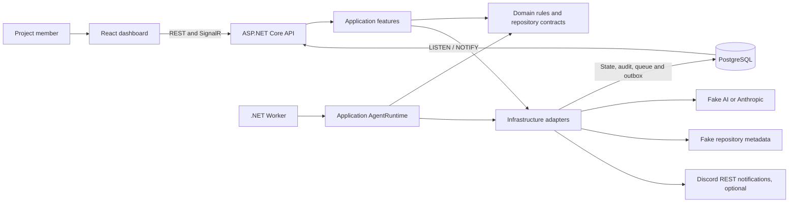
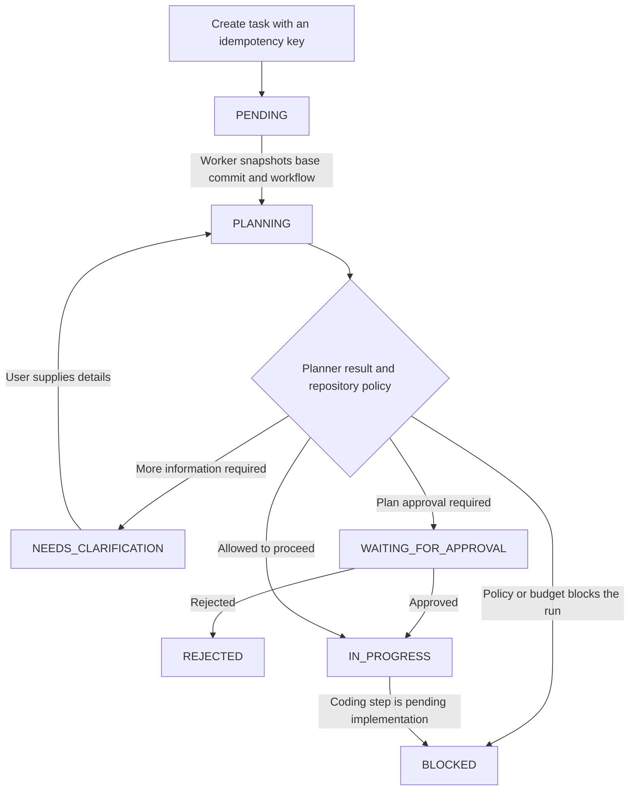

# DevAgent

DevAgent is a pilot platform for coordinating AI-assisted software maintenance. The current system accepts tasks through the dashboard and REST API, plans changes, applies repository policy, and records approvals and execution history. The [MVP checklist](docs/MVP-CHECKLIST.md) defines the remaining work for isolated code changes, build and review, and pull request delivery.

## Current architecture



The API and Worker are separate processes that share PostgreSQL. The arrows describe requests, events, and calls through ports at runtime. The compile-time dependency rules are covered by [architecture tests](backend/tests/DevAgent.ArchitectureTests/LayerDependencyTests.cs).

| Area | Responsibility |
| --- | --- |
| [Domain](backend/src/DevAgent.Domain) | Aggregates, value objects, events, and module-owned repository contracts. Code enforces state transitions, permissions, budgets, and approval rules across the backend. |
| [Application](backend/src/DevAgent.Application) | Use cases and module registration in `Features/`, integration ports in `Abstractions/`, and Worker-only orchestration, planning, budget checks, and job handlers in `AgentRuntime/`. |
| [Infrastructure](backend/src/DevAgent.Infrastructure) | EF Core mappings and repositories, read projections, PostgreSQL jobs and realtime events, AI and notification adapters, and telemetry. |
| [API](backend/src/DevAgent.Api) and [Worker](backend/src/DevAgent.Worker) | The API hosts REST, authentication, SignalR, and health endpoints. The Worker hosts job processing, heartbeats, and dead-letter reconciliation. |
| [Dashboard](frontend/src) | React routes and guards, shared layout and UI primitives, and feature-level pages, components, and TanStack Query data access. The dashboard UI is in Vietnamese. |

In the domain model, `AgentProfile` describes configuration, `AgentInstance` represents an active instance, and `AgentExecution` records a specific run and its usage. Tasks keep the status history. Approvals bind a decision to a specific plan version or diff.

## Task processing today



The diagram shows the planning paths. Eligible tasks also support cancellation and retry. A transient job failure is retried within its limits. Exhausting those attempts can move the task to `FAILED`.

| Capability | Current behavior |
| --- | --- |
| Projects and tasks | Register repositories and path policies, manage project roles, create tasks idempotently, filter and page lists, cancel, provide clarification, and retry. |
| Planning and approvals | Resolve the starting commit and list repository paths through an adapter. Generate a plan, record usage, and evaluate affected paths in code. A reviewer can approve or reject a specific plan revision. |
| Authentication | Short-lived JWT access tokens, rotating HttpOnly refresh cookies, temporary passwords, account administration, and project-scoped permissions. |
| Jobs and recovery | PostgreSQL leases with renewal, backoff and `Retry-After`, job-type concurrency limits, and dead-letter reconciliation. A Worker cancels its local work when it loses the lease. |
| Budget | Count attempted model calls, cap requested output based on remaining estimated USD and token budgets, and block a call when model pricing is missing. |
| Notifications | Record Discord notification jobs in the same database transaction as the corresponding task updates. Retry transient failures and use a nonce to reduce duplicate sends. |
| Dashboard and operations | Track tasks, timelines, executions, and approvals. SignalR events prompt a refetch of persisted data. Health checks, structured logs, and OpenTelemetry cover the API and Worker. |

The pilot uses simulated repository metadata. Setting `GitHub:Mode=App` selects an unavailable adapter. GitHub App access and webhooks, incoming Discord commands, the Docker execution sandbox, Coding, Testing, Reviewer, Publisher, and pull request creation are planned. See the [implementation roadmap](docs/IMPLEMENTATION_ROADMAP.md).

## Local development

Use [.NET 10](backend/global.json), Node.js 24, npm, and Docker with Linux containers. The examples use PowerShell from the repository root.

### Start the full stack

Create `.env` from the example if you are setting up a new checkout. Set `POSTGRES_PASSWORD`, `AUTH_JWT_SIGNING_KEY`, and `BOOTSTRAP_ADMIN_PASSWORD` before startup.

```powershell
Copy-Item .env.example .env
docker compose up -d --build
```

Open the dashboard at `http://localhost:8080` or check API readiness at `http://localhost:5080/health/ready`. Compose defaults to Development with the fake AI and repository adapters.

Sign in with `BOOTSTRAP_ADMIN_EMAIL` and the temporary password from `.env`, then change the password when prompted. The API creates the first Super Admin if needed. Use the user administration page to add accounts and the projects page to create a project, assign its owner, and register a repository. For the fake adapter, use installation ID `1`, repository `devagent-pilot/sample-app`, and branch `main`. Set the automatic fix scope to `src/**` and `tests/**` and keep the authentication paths sensitive.

The JWT signing key needs at least 32 bytes and should stay stable across restarts. You can generate one with `openssl rand -base64 48`. The default password policy requires at least 10 characters, including an uppercase letter, a lowercase letter, and a number. Set `AUTH_COOKIE_SECURE=true` when the dashboard uses HTTPS.

### Run services separately

With `.env` configured, start PostgreSQL using `docker compose up -d postgres`. Set connection and authentication variables in your terminal for `dotnet run`. Compose reads `.env` for interpolation.

Start the API in one terminal.

```powershell
$env:ConnectionStrings__Postgres = 'Host=localhost;Port=5432;Database=devagent;Username=devagent;Password=<POSTGRES_PASSWORD>'
$env:Auth__Jwt__SigningKey = '<AUTH_JWT_SIGNING_KEY>'
$env:Bootstrap__SuperAdmin__Email = '<BOOTSTRAP_ADMIN_EMAIL>'
$env:Bootstrap__SuperAdmin__Password = '<BOOTSTRAP_ADMIN_PASSWORD>'
Set-Location backend
dotnet tool restore
dotnet run --project src/DevAgent.Api
```

In Development the API applies migrations and bootstraps the first administrator when configured. The local launch profile uses `http://localhost:5080`, with OpenAPI at `/openapi/v1.json`.

Start the Worker from the repository root in a second terminal.

```powershell
$env:ConnectionStrings__Postgres = 'Host=localhost;Port=5432;Database=devagent;Username=devagent;Password=<POSTGRES_PASSWORD>'
Set-Location backend
dotnet run --project src/DevAgent.Worker
```

Start the dashboard from the repository root in a third terminal.

```powershell
Set-Location frontend
npm ci
npm run dev
```

Open `http://localhost:5173`. Vite proxies `/api` and `/hubs` to the API. The frontend stores the access token in memory and uses an HttpOnly refresh cookie. Signing out clears the client session and stops the realtime connection.

### Exercise the Planner

Create a task for the registered pilot repository and inspect its timeline.

| Fake AI input | Expected outcome |
| --- | --- |
| Ordinary bug report | Produces a plan, then reaches `BLOCKED` at the Coding placeholder. |
| Description contains `[sensitive]` | Proposes an authentication path. With the sample repository's matching policy, the task reaches `WAITING_FOR_APPROVAL`. |
| Description contains `[clarify]` | Reaches `NEEDS_CLARIFICATION` with a follow-up question. |

Approving the sensitive plan resumes processing through the Coding placeholder.

## Repository workflow settings

Edit a repository's workflow in the dashboard or at `GET/PUT /api/v1/repositories/{repositoryId}/workflow`. New repositories use version 0, the system default. An update requires `expectedVersion`. Stale updates return HTTP 409, and successful updates create a revision and an audit entry. The Worker snapshots the definition when starting a task.

| Setting | Values |
| --- | --- |
| Plan and diff approval | `ON_SENSITIVE` or `ALWAYS`. Sensitive changes retain an approval gate. |
| Planner attempts per run | 1 to 5. |
| Fix and test iterations | 0 up to the configured `AgentLimits:MaxFixIterations` limit. |
| Publishing review threshold | `LOW`, `MEDIUM`, or `HIGH`. |
| Models | Planner, Coding, and Reviewer overrides must have a price in `Ai:Pricing`. |
| Test and PR preferences | Regression test requirement, draft mode, labels, title prefix, and reviewers. |
| Discord notifications | Per-event settings. `APPROVAL_REQUIRED`, `COMPLETED`, and `FAILED` remain enabled. |

The Planner currently uses its configured approval mode, attempt limit, and model. Notification settings also take effect today. Coding, Reviewer, diff approval, and PR settings are validated, stored, and snapshotted for future steps.

## Configuration and secrets

[.env.example](.env.example) lists Compose settings. The API and Worker also read `appsettings.json`, their environment-specific settings files, and hierarchical environment variables such as `Ai__Provider` and `Ai__Anthropic__ApiKey`.

| Settings | Purpose |
| --- | --- |
| `ConnectionStrings`, `Database` | PostgreSQL, migrations, and seeding. |
| `Auth`, `Bootstrap`, `Cors`, `RateLimiting` | Authentication, initial administrator, allowed origins, and request limits. |
| `Ai`, `GitHub`, `Discord` | Adapter selection and integration credentials. |
| `AgentLimits`, `JobQueue`, `Worker` | Budgets, time limits, retries, leases, and concurrency. |
| `Security`, `Observability`, `PublicUrls` | Secret encryption, telemetry, and dashboard links. |

Use environment variables or a secret store for real values. Treat every `VITE_*` value as public. See the [secret setup notes](secrets/README.md).

The dashboard container generates `/config.js` at startup using `DEVAGENT_ENVIRONMENT`, `DEVAGENT_API_BASE_URL`, `DEVAGENT_SIGNALR_HUB_PATH`, and `DEVAGENT_APP_NAME`. The development server uses `VITE_*` settings. The [GitHub App Compose overlay](docker-compose.github-app.yml) describes the future private-key mount.

For local telemetry, run `docker compose --profile observability up -d` with `OTLP_ENDPOINT=http://otel-lgtm:4317` for containerized API and Worker processes. Use `Observability__OtlpEndpoint=http://localhost:4317` for processes on the host. Grafana is exposed at `http://localhost:3000`.

## Verification

```powershell
Set-Location backend
dotnet restore DevAgent.slnx
dotnet tool restore
dotnet build DevAgent.slnx -c Release --no-restore
dotnet format DevAgent.slnx --verify-no-changes --no-restore
dotnet test DevAgent.slnx -c Release --no-build
dotnet ef migrations has-pending-model-changes --project src/DevAgent.Infrastructure --startup-project src/DevAgent.Api --no-build --configuration Release

Set-Location ../frontend
npm ci
npm run typecheck
npm run lint
npm test
npm run build
```

Run Vitest from an uppercase drive path on Windows, such as `D:\Web\DevAgent\frontend`. Integration tests use Testcontainers and require Docker. [CI](.github/workflows/ci.yml) also applies migrations to a fresh database and builds all three images. For a model change, generate a migration from `backend/` and review its SQL.

```powershell
dotnet ef migrations add <MigrationName> --project src/DevAgent.Infrastructure --startup-project src/DevAgent.Api --output-dir Persistence/Migrations
```

See the [MVP acceptance checklist](docs/MVP-CHECKLIST.md), the [current code review](docs/audit/SOURCE_CODE_AUDIT.md), and the [proposed Agent Harness ADR](docs/adr/0001-agent-harness-runtime.md).
