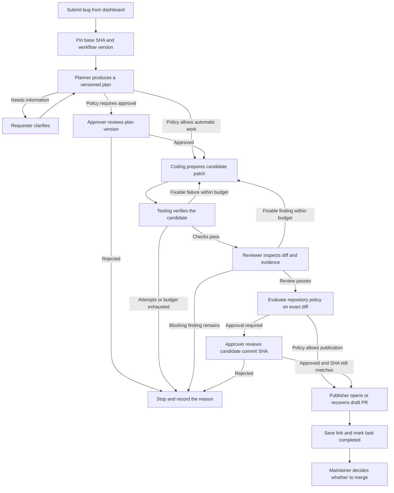

# DevAgent engineering office and workflow expansion

**Status** · Proposed implementation plan. PR 2 implemented: `Departments` module, migration `ItDepartments`, `/api/v1/projects/{projectId}/departments`, and the 2D office under `frontend/src/features/office/`. [ADR-0002](adr/0002-it-departments-module.md)

## Pilot outcome

A project member submits a reproducible bug from the dashboard. DevAgent proposes a plan, applies an approved change in an isolated workspace, runs build and tests, reviews the actual diff, and opens one draft pull request with the evidence. A maintainer merges it in GitHub. The dashboard shows the same run as a task timeline and in a configurable IT department with 2D and interactive 3D views.

Start with one project, one allowlisted repository, one build and test profile, and one reproducible bug. For example, use a status filter that returns rows from the wrong status. Capture the failing regression test on the base commit, the passing test on the candidate commit, the approval record when required, and the draft PR URL. This pilot informs the broader Agent Harness design. [MVP checklist](MVP-CHECKLIST.md) · [Agent Harness roadmap](IMPLEMENTATION_ROADMAP.md)

## Starting point

| Existing capability | Use in this plan |
| --- | --- |
| `PlannerAgent` runs in the Worker and uses Fake or Anthropic through `IModelClient` | Keep Planner as the entry step. Pass bounded repository context from the pinned commit. Use Fake in deterministic CI. |
| `WorkflowDefinition` stores versioned repository settings | Keep it as repository configuration for the fixed pipeline. Record the version on each run and check current permissions and repository policy at side-effect boundaries. |
| `AgentTask`, `AgentExecution`, approvals, and PostgreSQL jobs | Reuse task state, execution attempts, usage, leases, and approval records. Add durable stage evidence where the current records cannot represent it. |
| `PendingImplementationStep` handles Coding, Testing, Reviewing, and Publishing | Replace one state handler at a time and extend the existing Worker tests as each step becomes executable. |
| React dashboard, project access, task APIs, and SignalR | Add a project-scoped office view using the existing routes, query cache, and API authorization. |

[Agent runtime registration](../backend/src/DevAgent.Application/AgentRuntime/AgentRuntimeModule.cs) · [Task state machine](../backend/src/DevAgent.Domain/Tasks/AgentTaskStateMachine.cs) · [Workflow definition](../backend/src/DevAgent.Domain/Workflows/WorkflowDefinition.cs)

## Workflow and responsibilities



| Station | Implementation | Handoff evidence |
| --- | --- | --- |
| **Tiếp nhận & lập kế hoạch** | The existing Planner reads task input and a bounded snapshot at the base SHA. The backend validates its structured result and evaluates planned paths. | Plan version, affected paths, risks, acceptance criteria, source SHA, and model usage. |
| **Phát triển** | A Coding step uses a bounded model loop and typed read, search, and patch actions. The Worker checks paths and policy before applying each patch. Stop for a revised plan and approval if the work expands beyond the authorized scope. | Candidate SHA or recoverable workspace reference, changed paths, tool outcomes, and attempt number. |
| **Kiểm thử** | A deterministic Testing step runs the registered build and test profile in the sandbox. A fixable failure can return to Coding within the configured iteration and task budget. | Candidate SHA, command profile, exit codes, duration, bounded logs, and regression test result. |
| **Rà soát** | A separate Reviewer execution reads the diff and test evidence. The backend applies the configured severity threshold and evaluates the actual diff, including deletes and both sides of renames. | Findings, policy reasons, verified diff and SHA, and the disposition for each blocker. |
| **Phê duyệt** | An authorized human approves or rejects the exact plan version or candidate SHA. The project API owns the decision. Expired or superseded requests expose the reason and the action to request review again. | Reviewer identity, scope, decision time, subject version or SHA, and decision comment. |
| **Xuất bản** | A deterministic Publisher validates the prepared candidate and recorded checks, then uses the GitHub App to publish the task branch and find or create its draft PR. | Draft PR URL and number, head SHA, and the associated execution and test records. |

### Execution and recovery rules

- Save completed step evidence, the task transition, the successor job, and applicable outbox work together. Use the existing transition-based job key for ordinary progression and a stable attempt identifier for resumed work. Guard mutable state with concurrency checks and test recovery with two Workers.
- Pin base SHA, workflow version, and resolved model per run. Persist the policy version used for each gate. Before publishing, recheck current repository policy, candidate SHA, test and review evidence, and any required approval. A changed candidate invalidates prior verification and diff approval.
- Link work cancellation to task cancellation, lease loss, and active deadline. Bound model calls, output, elapsed time, and fix iterations. Handle uncertain model outcomes explicitly so a retry cannot silently make charged calls disappear from the task budget.
- Use a dedicated, unprivileged workspace with resource and network limits and cleanup after success, failure, cancellation, or timeout. Keep provider and GitHub credentials in Infrastructure. Use approved build and test profiles, validate typed tool inputs in the Worker, keep authorization in code, and treat model, repository, and issue text as data.
- Publish per task branch. After an uncertain GitHub response, look up the PR by repository and task branch, then verify base, head, and candidate SHA before adopting it. A mismatched remote branch or PR requires operator review. Persist the PR link before completing the task.
- Record a human-readable stop reason and next action for clarification, rejection, expiration, policy blocks, exhausted budgets, and failures. A task that has entered publication needs reconciliation of the remote result before its final status is recorded.

## Custom IT departments

A project can have multiple departments. Each department selects the project's repositories that it follows. A repository can appear in multiple departments. For example, `Nền tảng` can follow the platform API and worker repositories, while `Kiểm thử` can follow the API and UI repositories. Both departments show the same authoritative task and execution when they follow the same repository.

- **Create and customize.** Start from a built-in template for `Phát triển phần mềm`, `Kiểm thử`, or `Nền tảng & vận hành`. Owners can change the department name, repository selection, room labels, layout, theme, and furniture presets. They can add informational rooms such as `Bàn tiếp nhận` or `Runbook`, with actions from the app's approved destinations. An editor previews both 2D and 3D from the same layout, with drag and keyboard controls for moving or resizing rooms.
- **Bind rooms to the IT workflow.** Each published office has one room for each role from the responsibility table. The editor maps a role to a room so separate layouts can use different names and positions. Informational rooms carry no stage binding. `WorkflowDefinition` and the Worker own execution order, models, budgets, and repository policy. The Approve Changes permission continues to govern approvals.
- **Draft, publish, and restore.** `Lưu bản nháp` saves private edits for department managers. `Xuất bản` validates the full layout and creates a numbered revision. `Khôi phục phiên bản` copies a previous configuration into a new draft for review and publication. `Lưu trữ phòng ban` removes it from the active directory and preserves revision history. Task and execution records remain attached to their project and repository.
- **Scope access.** `ViewTasks` grants access to published, active departments in that project. Add `ManageDepartments` to the Owner role for draft, publish, restore, and archive operations. Apply existing authorization and repository scope to every query, mutation, and task subscription. The office's repository selection filters work shown in the office. Task creation and cancellation continue to use the existing project permissions.

### Architecture and API boundaries

| Layer | Planned responsibility |
| --- | --- |
| Domain | Add `Departments/ItDepartment` as the aggregate for office configuration, plus value objects for layout and room placements and an aggregate-specific repository contract. Use existing project and repository IDs. Validate role bindings, layout rules, and lifecycle transitions here. |
| Application | Add `Features/Departments` with one use case per file and registration in `DepartmentsModule.cs`. Resolve project access before loading a draft or changing the aggregate. Save publication and audit through the existing unit of work. Keep office reads as paginated projections and keep execution orchestration in the Worker. |
| Infrastructure | Map department data in the existing EF Core `devagent` schema. Scope published layout and task queries by project and department. Filter by the repository links for the active revision before pagination and use `AsNoTracking` projections. |
| API and frontend | Use `/api/v1/projects/{projectId}/departments` for list and create. Under `/{departmentId}`, use `GET` for published detail, `/tasks`, `/tasks/{taskId}`, and `/revisions`. Managers use `GET` and `PUT` on `/draft` and `POST` on `/publish`, `/revisions/{version}/restore`, and `/archive`. Return the saved revision or current edit version. Show published data and editing controls through the existing authenticated app shell. |

Keep the modular monolith and its API and Worker composition roots. The department feature depends on Projects and Repositories for authorization and scope. Worker steps depend on the task, repository workflow, and run evidence. Record this module boundary and data ownership in a proposed ADR before implementation. [Repository architecture rules](../AGENTS.md)

### PostgreSQL requirements

Use UUIDs for identities, `timestamptz` for audit timestamps, and named PostgreSQL constraints in the EF mappings. Require `NOT NULL` for IDs, ordering and geometry fields, labels, and audit fields. The active revision pointer, draft document, archive timestamp, and informational room's stage are nullable by design.

| Proposed table | Keys and constraints |
| --- | --- |
| `it_departments` | `id` primary key and `project_id` FK to `projects`. Unique `(project_id, id)` for scoped FKs and unique `(project_id, slug)` for a stable normalized slug, including after archive. Require positive `edit_version`. `draft_config` is a bounded, typed JSONB object when present. Nullable `(project_id, id, published_version)` references the revision within this department. |
| `it_department_revisions` | Primary key `(project_id, department_id, version)`. Scoped FK `(project_id, department_id)` to the department, a positive version, nonblank display name, approved theme preset, and `published_at` and `published_by` with an FK to `users`. Append a complete snapshot on each publication. |
| `it_department_revision_rooms` | Primary key `(project_id, department_id, version, room_id)` and scoped FK to the revision. Keep `room_id` stable across revisions for the same room. Require unique sort order per revision. Use a partial unique index on `(project_id, department_id, version, stage)` for rows with a stage. Constrain the stage to the supported workflow roles. In the 24 × 16 integer grid, enforce `x >= 0`, `y >= 0`, `width > 0`, `height > 0`, `x + width <= 24`, and `y + height <= 16`. Store labels and approved asset preset keys. |
| `it_department_revision_repositories` | Primary key `(project_id, department_id, version, repository_id)`. Require a composite FK to the revision and a composite FK `(project_id, repository_id)` to `code_repositories(project_id, id)`. Add the referenced unique key on `code_repositories`. Index `(project_id, repository_id)` on the link table for repository lookups and FK checks. |

- **Validate whole layouts on publish.** Require one assignment for each of the six stages, between 6 and 12 rooms, at least one permitted repository, and non-overlapping room rectangles. Enforce consistent limits in the editor and validate them again in Domain and Application. PostgreSQL enforces per-row bounds, uniqueness, and project ownership even if a write bypasses the UI. [PostgreSQL 17 constraints](https://www.postgresql.org/docs/17/ddl-constraints.html) · [Partial unique indexes](https://www.postgresql.org/docs/17/indexes-partial.html)
- **Publish atomically.** Require `expectedEditVersion` on draft, publish, restore, and archive commands. Configure `edit_version` as an EF concurrency token and increment it on each change. In one transaction, insert the next revision and its rooms and repository links, update the department's published pointer, clear the draft, and insert an audit entry. Convert a stale edit or a competing revision insert to HTTP 409. Readers keep seeing the previous published view until commit. [Current versioned workflow use case](../backend/src/DevAgent.Application/Features/Workflows/UpdateRepositoryWorkflow.cs)
- **Preserve history.** Use restrictive deletes on configuration history and archive departments through the API. Published configurations are append-only in the write path. Record create, publish, restore, and archive using the existing audit model with actor, project, department ID, version, and timestamp. Keep credentials and free-form executable content outside layout payloads.
- **Protect task data too.** Retain the unique task idempotency key and job deduplication key. Add a scoped `(project_id, repository_id)` FK on `tasks` after checking existing rows. Check existing `(task_id, step, attempt)` values before adding a unique constraint and reserve attempts before external calls. Use an FK for plan approval subjects `(task_id, plan_version)` and a `CHECK` requiring a plan version for `Plan` or a commit SHA for `Diff`, with the other field null. Validate the full candidate SHA and current approval again in the Publisher. [Task EF configuration](../backend/src/DevAgent.Infrastructure/Persistence/Configurations/TaskConfiguration.cs) · [Execution and approval EF configuration](../backend/src/DevAgent.Infrastructure/Persistence/Configurations/ExecutionConfigurations.cs)
- **Migrate additively.** Generate migrations with EF Core and review the SQL. Apply and test against both a fresh PostgreSQL 17 database and one upgraded from the current schema. Check existing data before tightening constraints. Existing projects start with an empty department directory and can create a department from a template. Retain current task and execution history.

## Dashboard and 3D office

Add the **Phòng kỹ thuật** directory at `/projects/:projectId/office`, linked from project detail. Open each published office at `/projects/:projectId/office/:departmentId` and its editor at `/projects/:projectId/office/:departmentId/settings`. Use `?taskId=<id>&view=3d` to share a selected run in that office. Keep the existing task and approval pages as the workflow entry points. Open the office in 2D immediately and load 3D when the user selects it. Both views use the same published layout, selected task, station highlights, and detail panel.

```text
┌───────────────────────────────────────────────────────────────────────────────────┐
│ Phòng kỹ thuật    Project / Repository            [2D] [3D]    [+ Tạo task]       │
├────────────────────┬─────────────────────────────────────┬────────────────────────┤
│ Task gần đây       │ Sơ đồ phòng ban / văn phòng 3D      │ Chi tiết công việc     │
│ Tìm task           │                                     │ Kiểm thử · Đang chạy   │
│ ● Lỗi bộ lọc       │ Lập kế hoạch → Phát triển           │ Repo · SHA · Lần thử   │
│   Sửa phân trang   │                     ↓               │ Kết quả build/test     │
│                    │ Phê duyệt ← Rà soát ← Kiểm thử      │ [Xem lần chạy]         │
│                    │     ↓                               │                        │
│                    │ Xuất bản                            │                        │
├────────────────────┴─────────────────────────────────────┴────────────────────────┤
│ Timeline của task đã chọn                                                         │
└───────────────────────────────────────────────────────────────────────────────────┘
```

### Visual direction and interaction

- **Art direction.** Use an isometric cutaway of a compact engineering floor. Build six identifiable station presets using simple geometry and a consistent material palette. Give Planner a planning table, Coding a workbench, Testing a bench with a status light, Reviewer a diff display, Approval a meeting table, and Publisher a release desk. Use a calm warm-gray shell and the dashboard's existing indigo accent as the default theme. Apply semantic colors for active, waiting, and failed states across themes. Keep labels and key actions in HTML using Geist and the current shadcn primitives. Use light and dark theme tokens.
- **Layout.** On desktop, let the floor take most of the screen with a compact task list and evidence panel beside it. On mobile, put the selected task and next action first, use a stacked 2D station list, and open evidence in a sheet. Keep the 2D option available at any width. Use concise Vietnamese labels, visible keyboard focus, and text plus color for each status.
- **Action model.** Select a task to follow it through the floor. Click a room or select it from the keyboard-accessible station list to open that step's evidence. Provide a reset-camera control and keep camera movement bounded. Show the primary action in the evidence panel, such as `Bổ sung thông tin`, `Xem yêu cầu duyệt`, `Xem kết quả kiểm thử`, or `Mở pull request`. Reuse existing permission-aware forms and routes.
- **Motion and truthfulness.** Move a task marker once when a persisted transition is confirmed. A running station can show a subtle indicator. A waiting station shows who needs to act when the API can supply that information. After reconnecting, restore the latest snapshot directly and offer the timeline for missed transitions. Show `Chưa triển khai` for unavailable stages and keep fixture-driven simulations in development and browser tests. The app office reads actual task data, including when the local stack uses Fake adapters.
- **Fallbacks.** Keep text, navigation, and actions usable with reduced motion, WebGL disabled, or renderer initialization or context failure. Distinguish loading, empty project, stale connection, access revoked, and failed task. Preserve selected task and step across 2D and 3D, and clear protected detail when access is revoked.

### Frontend and data integration

| Concern | Proposed implementation |
| --- | --- |
| Feature entry | `frontend/src/features/office/` owns the directory, editor, 2D view, details panel, and a separately loaded 3D scene under `components/`. Register routes in the current authenticated router and key department queries by project and department IDs. Invalidate published queries after publication and retain the local draft when a conflict is returned. |
| Source of truth | Use published department detail and the department task list and single-task routes to scope both pagination and deep links to the active revision's repositories. Reuse the task detail projection and existing execution and approval endpoints. Use `/api/v1/tasks/{id}/timeline?after=<sequence>` for incremental history. If a new revision removes the selected task's repository, clear that selection and its office subscription. |
| Mapping | Derive station highlights once from persisted task and execution data. Map `IN_PROGRESS` to Coding, `REVIEWING` to Reviewer, and `PUBLISHING` to Publisher. Use the approval kind for plan and diff review. Keep the last known station for stopped tasks and show its stop reason. Use shared date, token, and cost formatting. Show evidence as pending until its query resolves. |
| Realtime | Subscribe to the selected task after access checks. Treat SignalR as a refresh hint. Coalesce refreshes and deduplicate timeline entries by task ID and sequence. Recover missed pages using the cursor on reconnect. Refresh the bounded task list separately. |
| 3D renderer | Use Three.js and a stable React Three Fiber release compatible with the installed React version. Start with reusable geometry, one orthographic camera, modest light, and local assets only. Lazy-load the renderer and use on-demand frames, bounded pixel ratio, and a 2D fallback. Verify library compatibility and package size in the 3D PR. [React Three Fiber compatibility](https://r3f.docs.pmnd.rs/getting-started/installation) · [Canvas and fallbacks](https://r3f.docs.pmnd.rs/api/canvas) · [On-demand rendering](https://r3f.docs.pmnd.rs/advanced/scaling-performance) |

## Delivery order

| PR | Work | Acceptance |
| --- | --- | --- |
| **1 · Stabilize current execution** | Fix refresh-token rotation under concurrency, trusted-proxy auth limits, and SignalR revocation and token expiry. Wire task cancellation and deadlines into active Planner calls. Complete timeline cursor paging and approval expiry behavior. | PostgreSQL and API tests cover concurrent refresh, access revocation, and cancellation during a model call. A closed connection or expired approval has a recoverable UI state. |
| **2 · Custom departments and Office 2D** | Add the constrained schema, project-scoped API, IT templates, draft editor, and published 2D view. Reuse task creation, approval links, timeline, evidence, and existing theme components. | An Owner creates two departments, customizes one, publishes it, and restores a previous layout as a new revision. The correct Planner tasks appear at 390 px and 1,440 px. Verify keyboard editing, cross-project rejection, and stale draft conflicts. |
| **3 · Office 3D** | Render the same published rooms and optional informational rooms in a lazy-loaded isometric floor. Add shared selection, marker movement on confirmed transitions, an editor preview, and 2D fallback. | A renamed or moved room updates consistently in both views after publish. The dashboard and 2D route fetch no 3D code. Test WebGL failure, reduced motion, and recovery after SignalR reconnect. |
| **4 · Repository access and sandbox** | Connect the pilot GitHub App for pinned reads. Implement sandbox lifecycle and deterministic baseline build and test against the selected repo. Keep integration and sandbox code in Infrastructure. | A clean baseline run produces bounded evidence. Timeout, cancellation, and Worker interruption reclaim the workspace or allow documented recovery. |
| **5 · Coding, testing, and review** | Add the bounded Coding step, deterministic Testing, and diff-focused Reviewer. Persist candidate SHA, test results, tool evidence, policy reasons, and diff approvals. | A fixture bug reproduces, is repaired, and passes verification. A failed test, blocking finding, prohibited path, or unapproved changed SHA stops publication. |
| **6 · Draft PR and recovery** | Implement Publisher, draft PR content, linked evidence, and outbox notification. Validate with the real GitHub App on the pilot repository. | One task yields one draft PR, including when the Worker restarts after GitHub responds and before the link is saved. The PR includes an English title and body, the task link, and test evidence. |

PRs 2 and 3 can use today's Planner data while sandbox work proceeds. The 3D scene consumes the same data contract as 2D, so releases can progress independently. Keep the fixed pipeline through the pilot. Use observed handoffs and operator feedback to prioritize a versioned agent registry, additional providers, Discord or GitHub Issue intake, a workflow designer, and parallel agents. Runtime changes covered by the proposed Agent Harness ADR retain their design review. [ADR-0001](adr/0001-agent-harness-runtime.md)

## Performance and pilot sign-off

- **Measure before tuning.** Record task durations per step, model calls, token and estimated cost per task, job retries, and recovery results with the existing telemetry. Compare the same pilot task before and after changes. Use a small, bounded context and keep the existing PostgreSQL queue while pilot traffic fits it.
- **Keep the renderer lightweight.** Use 500 KiB compressed as a starting target for incremental 3D code and initial scene assets, measured from the production build. Confirm the scene stops drawing when idle and when the tab is hidden. Check at least one desktop browser and one phone-sized or lower-powered browser environment. Preserve the 2D view and tune geometry and resolution using those measurements.
- **Verify release gates.** Run backend Release build, format check, tests, EF model check, frontend typecheck, lint, tests, and build. Use deterministic Fake adapters in CI, then separately validate one real-provider run with the GitHub App on the pilot repository. Confirm the responsive UI, keyboard flow, revoked-access state, and reconnect behavior in a running browser.
- **Verify department constraints.** Use PostgreSQL integration tests to reject cross-project links, duplicate slugs and stage bindings, out-of-bounds rooms, and a published pointer to a different department. Add API tests for owner-only editing, atomic publication, competing edits, and restore as a new version. A browser test follows an existing task across a room rename and layout change in both views.
- **Record acceptance evidence.** Save the test before and after results, draft PR URL, run duration and cost, restart recovery result, and screenshots of the 2D mobile and 3D desktop views in the pilot review. For the pilot, a maintainer reviews the patch and decides whether to merge.
