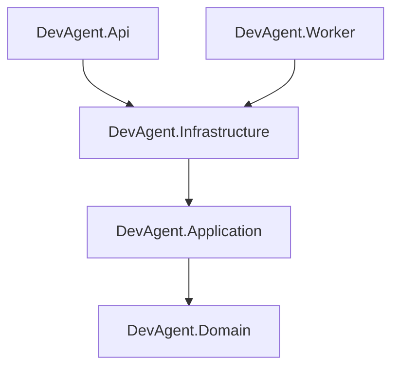
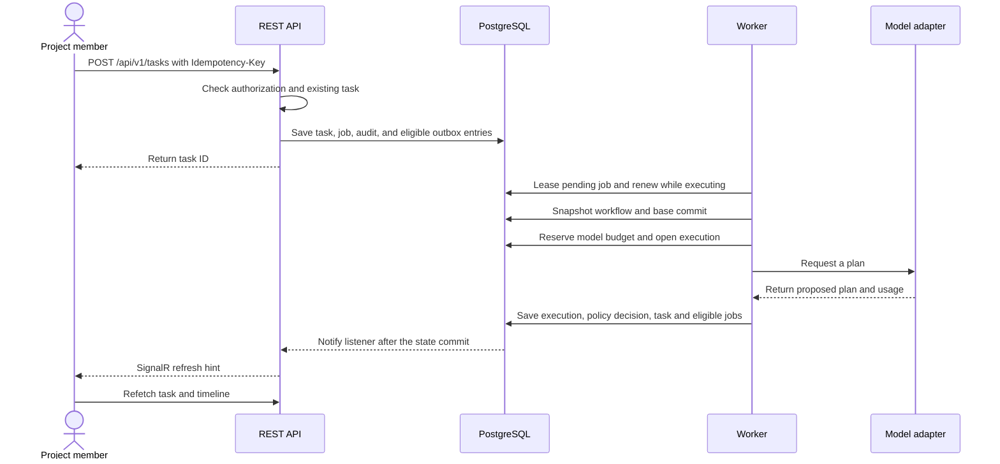
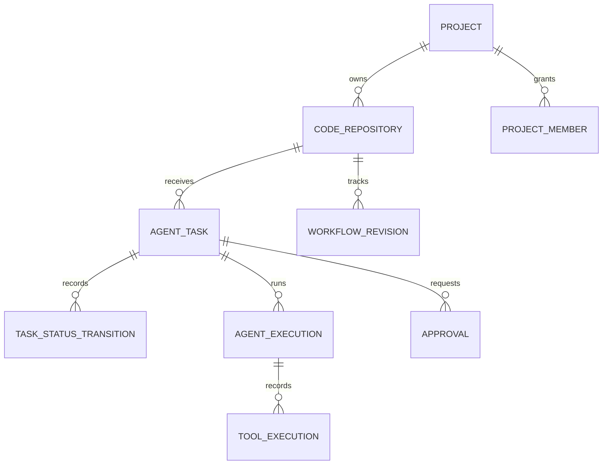

# Architecture review · M0

## Current boundaries

DevAgent is a modular monolith with two processes and a shared PostgreSQL database. The API hosts REST, JWT authentication, SignalR, and health checks. The Worker hosts job processing, leases, heartbeat, and dead-letter reconciliation.

These arrows show direct project references. The API and Worker also use Application and Domain types through transitive references. Domain owns aggregates and repository contracts under `<Module>/Repositories/`. Application groups use cases by feature and reserves `AgentRuntime/` for Worker use. Infrastructure owns EF Core, PostgreSQL, integrations, and observability. Read handlers use dedicated `AsNoTracking` projections in [ReadQueries.cs](../../backend/src/DevAgent.Infrastructure/Persistence/Queries/ReadQueries.cs).

The [architecture suite](../../backend/tests/DevAgent.ArchitectureTests/LayerDependencyTests.cs) checks the framework and layer boundaries, the location of repository contracts, the isolation of the runtime, and aggregate setter visibility.

## Create and run a task

1. `CreateTaskHandler` checks that the repository is active and the caller has `CreateTasks`. If an idempotency key races with another request, the duplicate path returns the task persisted by the winning request.
2. `EfUnitOfWork` dispatches transaction-bound handlers, commits the task, processing job, audit, and eligible notification jobs, then dispatches post-commit events. The PostgreSQL listener relays refresh hints to authorized SignalR groups.
3. `PostgresJobQueue` uses an advisory transaction lock and `FOR UPDATE SKIP LOCKED` for leasing. `JobProcessingService` renews leases and cancels local work on loss. `AgentOrchestrator` checks state, active timeout, and repository availability before choosing a step.
4. `StartTaskStep` fixes the base commit and repository workflow for the task. `PlanningStep` reserves budget, records execution and usage, and evaluates its proposed paths. It asks for clarification, requires approval, blocks the task, or advances to `IN_PROGRESS`. The Coding placeholder then moves authorized work to `BLOCKED`.
5. `DecideApprovalHandler` checks `ApproveChanges`, the task's waiting status, and the plan version. A stale plan supersedes the approval. An accepted decision queues the next step.
6. The dead-letter reconciler marks eligible tasks failed and closes abandoned executions. Its own lease permits recovery after an interruption.

PostgreSQL `xmin` provides optimistic concurrency for mutable EF mappings. Planning saves model usage independently before the final task update so a concurrent cancel does not discard recorded charges.

## Domain relationships

The diagram gives the main domain relationships. The schema also includes users, refresh tokens, audit entries, jobs, and agent instances. The optional PR link is part of the task model, and the current runtime records planning executions. [EF configurations](../../backend/src/DevAgent.Infrastructure/Persistence/Configurations) define the physical keys and indexes.

## Findings

| ID | Priority | Evidence and impact | Proposed change and acceptance |
| --- | --- | --- | --- |
| ARC-001 | High | `AgentOrchestrator.AdvanceAsync` selects hand-written steps by task status. Custom agents, user-defined workflows, and coordination require changes to application code. | Adopt separate versioned agent definitions, a bounded runtime, and a workflow graph if ADR-0001 is approved. Verify the existing Planner's behavior on the new path. |
| ARC-002 | Medium | `AgentExecution.TaskId` is required. Standalone agent runs and node-level execution lack a suitable record. | Add workflow and node execution records and optional associations while preserving existing task links. Verify standalone runs and version traceability. |
| ARC-003 | Medium | The provider and pricing are configured for the whole service. | Add a provider and model catalog with encrypted credentials. See SRC-006 and ADR-0001. |
| ARC-004 | Medium | `TaskRealtimeEvent` represents task-level refresh signals. Events outside status transitions have sequence 0. | Add ordered execution events once there are model and tool invocations to inspect. Verify ordered catch-up after reconnect. |
| ARC-005 | Low | Project membership provides the current isolation boundary. | Introduce organization-scoped projects and queries when multi-organization deployment is required. |
| ARC-006 | Low | The API consumes DTOs defined in Application features. | Keep the current arrangement for the dashboard-backed API. Revisit contract packaging if a second .NET consumer needs it. |

## Target module mapping

| Module | Current or proposed home |
| --- | --- |
| Identity | `Domain/Users`, `Features/Auth`, and `Features/Admin`. |
| Policies | `Domain/Policies` and per-repository `Domain/Workflows`. |
| Tasks, approvals, audit | `Domain/Tasks`, `Domain/Approvals`, `Domain/Auditing`, and their application use cases. |
| Budget and executions | `AgentRuntime/Budget`, `Domain/Executions`, and `Features/Executions`. Extend the current per-task model in M2. |
| Providers, models, and agents | Proposed `Domain/Providers` and versioned definitions in `Domain/Agents` in M2. |
| Tools and context | Proposed tool registry, runtime context assembly in M2, and memory work in M5. |
| Workflow graphs | Proposed graph definitions and durable execution in M3, using the PostgreSQL queue. |
| Workspaces, evaluations, and artifacts | Proposed M4 work. |

The proposed design preserves the current solution and project names. PostgreSQL remains the durable job store for the pilot. Broker changes require workload evidence.
